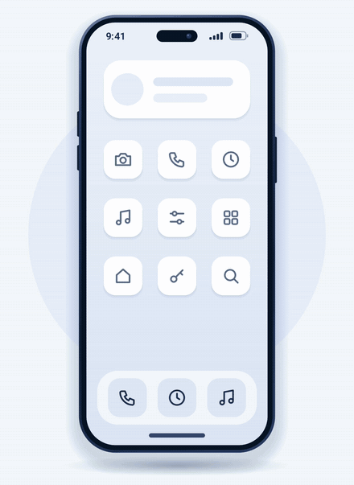
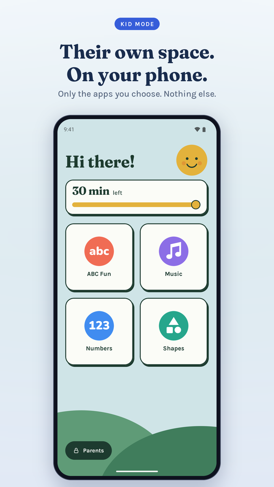
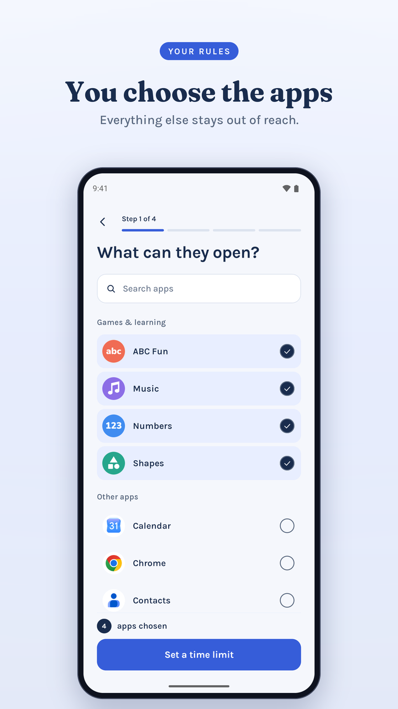
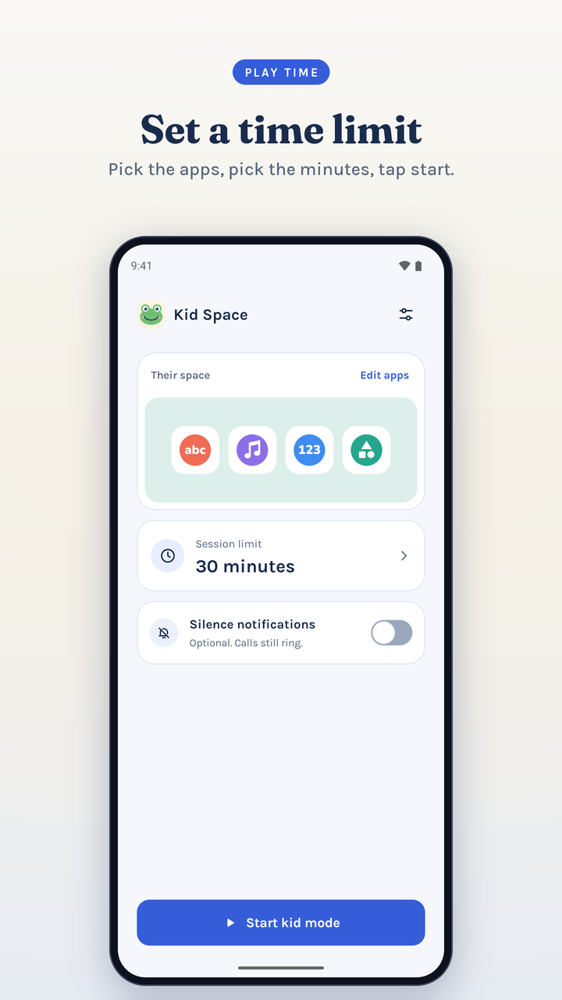
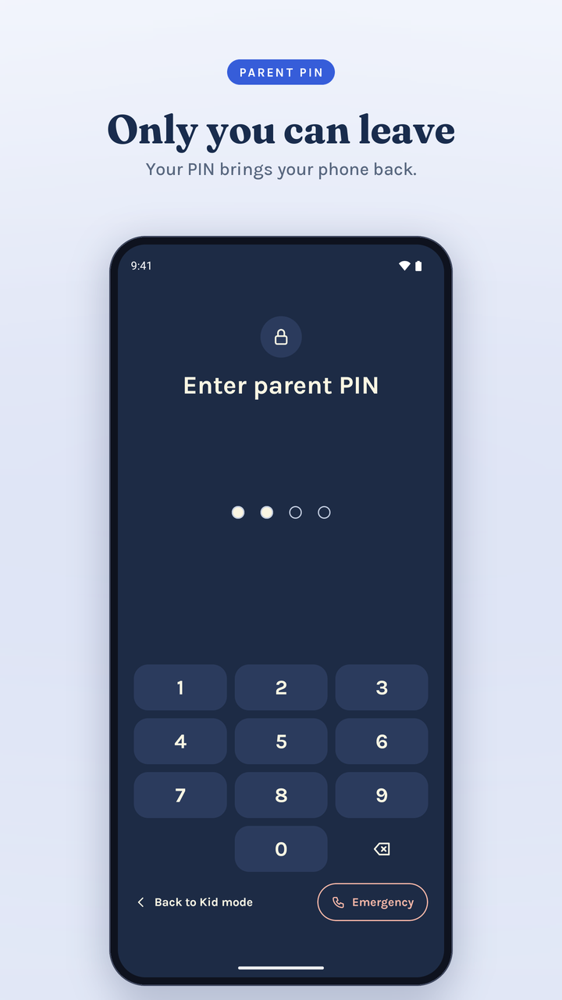

<p align="center">
  
</p>

<h1 align="center">Kid Space</h1>

<p align="center">Their own space. On your phone.</p>

<p align="center">
  <a href="https://github.com/PankoByte/kidspace/releases/latest"></a>
  <a href="https://github.com/PankoByte/kidspace/actions/workflows/ci.yml"></a>
  <a href="LICENSE"></a>
</p>

Kid Space is an Android app for the moment you hand your own phone to a child. You pick the apps they may open and how long they may play. The phone then shows only those apps until you type your parent PIN.

It does not replace your launcher. Kid Space becomes the home app only while Kid mode is running, and gives the home screen back to your normal launcher when you leave.

<p align="center">
  
</p>

<p align="center">
  
  
  
  
</p>

## What it does

- Shows the child a home screen with only the apps you chose.
- Sends the child back to that home screen if any other app comes to the front.
- Closes the notification panel during Kid mode, so quick settings and your notifications stay out of reach.
- Runs a play timer (15, 30, 45 or 60 minutes, a custom time, or no limit). When time is up the phone shows a "Time's up" screen until a parent types the PIN.
- Can silence notifications during Kid mode. Calls still ring. This is optional.
- Keeps an Emergency link on the PIN screen that opens the phone dialer.
- Speaks 13 languages: English, Spanish, Portuguese (Brazil), French, German, Hindi, Indonesian, Russian, Arabic, Japanese, Korean, Chinese (Simplified) and Turkish.

## Why the code is public

A parental control app asks for a lot of trust. Kid Space uses Android's Accessibility permission, which can be misused by apps to watch what you do. Publishing the code lets anyone check what this app does with it.

The short version, with the files to read if you want to check:

| Claim | Where to look |
| --- | --- |
| The app cannot use the internet. It does not request the `INTERNET` permission, so Android blocks all network access. | [AndroidManifest.xml](app/src/main/AndroidManifest.xml) |
| The Accessibility service cannot read what is on screen. `canRetrieveWindowContent` is `false`. It only learns the package name of the app in front. | [kid_guard_service.xml](app/src/main/res/xml/kid_guard_service.xml), [KidGuardAccessibilityService.kt](app/src/main/java/com/pankobyte/launcher/guard/KidGuardAccessibilityService.kt) |
| The service does nothing while Kid mode is off. | [GuardLogic.kt](app/src/main/java/com/pankobyte/launcher/guard/GuardLogic.kt) |
| The PIN is never stored. The app keeps a salted PBKDF2-HMAC-SHA256 hash (120,000 rounds) and locks the PIN pad after 5 wrong tries. | [PinLogic.kt](app/src/main/java/com/pankobyte/launcher/kid/pin/PinLogic.kt) |
| App data is excluded from cloud backup and from phone-to-phone transfer. | [data_extraction_rules.xml](app/src/main/res/xml/data_extraction_rules.xml) |
| No ads, no analytics, no third-party SDKs. The only libraries are AndroidX and Kotlin. | [libs.versions.toml](gradle/libs.versions.toml) |

## Permissions

| Permission | Needed? | What it is for |
| --- | --- | --- |
| Accessibility service ("Kid Space app protection") | Required | Tells the app which app is in front, so it can send the child home from apps you did not choose. |
| Default home app | Required, only during Kid mode | Makes the Home button land on the kid home screen. Handed back when you leave Kid mode. |
| Foreground service | Required | Runs the play timer and shows the "Kid mode is on" notification. |
| Usage access | Optional | A second check once a second, in case Android stops the Accessibility service. |
| Do Not Disturb access | Optional | Silences notifications during Kid mode and restores your earlier setting afterwards. |

## Limits you should know about

Kid Space is a guard for a lent phone. It is not a full parental control suite.

- An allowed app opens with your account and your content. Kid Space does not filter what is inside an app.
- There is no PIN recovery. If you forget the PIN, you need to clear the app's data from Android settings and set it up again.
- When Kid mode ends, some phones ask you to choose your normal home app again.
- It has been tested on a small number of devices. Manufacturer versions of Android differ, and a determined older child may find ways around it. Please [report](SECURITY.md) any escape you find.

## Install

Download the APK from the [latest release](https://github.com/PankoByte/kidspace/releases/latest) and open it on your phone. Android will ask you to allow installs from your browser or file manager.

Requires Android 8.0 or newer.

A build from GitHub and a build from an app store are signed differently. Android will not update one over the other; uninstall first if you switch.

## Build from source

You need Android Studio (or the Android SDK with platform 36). Gradle downloads JDK 17 by itself if you do not have it.

```bash
git clone https://github.com/PankoByte/kidspace.git
cd kidspace
./gradlew assembleDebug        # APK in app/build/outputs/apk/debug/
./gradlew testDebugUnitTest    # unit tests
./gradlew lintDebug            # Android lint
```

A release build is unsigned unless you add a `keystore.properties` file in the project root. Git ignores this file and the keystore itself.

```properties
storeFile=release.keystore
storePassword=...
keyAlias=...
keyPassword=...
```

## How the code is laid out

All code is in one Gradle module, `app`. The Kotlin package is `com.pankobyte.launcher`, a name left over from the first version. The installed app ID is `com.pankobyte.kidspace`.

| Package | What is in it |
| --- | --- |
| `guard` | The Accessibility service, the allowlist decision (`GuardLogic`), the session service with the timer, Do Not Disturb control. |
| `kid.session` | The Kid mode state machine and the manager that saves every state change before applying it. |
| `kid.pin` | PIN hashing, lockout timing, the PIN pad and PIN screens. |
| `kid.home` | The screens the child sees. |
| `kid.setup` | Parent screens: first-run setup, app picker, parent home, settings. |
| `core.apps` | Reading the installed apps and their icons. |
| `core.data` | Room database (allowed apps, sessions) and DataStore settings. |
| `core.perms` | Permission checks and the switch that turns the home-app entry on and off. |
| `core.theme`, `core.ui` | Colours, fonts, shared Compose components. |

The UI is Jetpack Compose with no navigation library and no dependency injection framework. The decision logic in `GuardLogic`, `KidLogic` and `PinLogic` is plain Kotlin and covered by unit tests in `app/src/test`.

[docs/DESIGN.md](docs/DESIGN.md) explains the reasoning behind the parent-side screens.

## Feedback and bug reports

Open an [issue](https://github.com/PankoByte/kidspace/issues) for bugs and suggestions. For anything that lets a child get out of Kid mode, follow [SECURITY.md](SECURITY.md) instead so it is not public before a fix. [CONTRIBUTING.md](CONTRIBUTING.md) covers code changes.

## License

Kid Space is source-available under the [PolyForm Strict License 1.0.0](LICENSE). The code is public so you can inspect it, but this is not an open source license in the OSI sense.

In plain words: you may read the code, and build and run it for your own noncommercial use. You may not distribute it, and you may not make or publish modified versions. The [LICENSE](LICENSE) file is the binding text.

The bundled fonts and libraries keep their own licenses. See [THIRD_PARTY_NOTICES.md](THIRD_PARTY_NOTICES.md).

Copyright © 2026 PankoByte.
